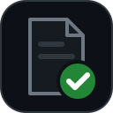
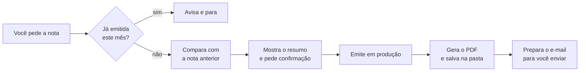

<div align="center">



# nfse-cli

**Emita NFS-e pela API nacional da Receita, do terminal ou pedindo ao seu agente de IA.**<br>
Sem passar pelo site do governo e sem biblioteca de terceiros mexendo no seu certificado.

[](https://github.com/regisdias/nfse-cli/actions/workflows/ci.yml)
[](LICENSE)
[](#instalação)
[](#funciona-com-quais-agentes)

</div>

> [!NOTE]
> **Em desenvolvimento.** A biblioteca, a linha de comando, a Lambda e a geração do PDF já funcionam e emitem
> notas reais em produção. A skill e o instalador de um comando chegam nas próximas versões; até lá, a
> instalação é [manual](#instalação-manual).

---

## O que é

A NFS-e nacional tem uma API própria (Sefin Nacional), autenticada pelo certificado digital A1 da empresa.
Este projeto conversa com ela diretamente: monta a nota, assina, confere contra o esquema oficial e envia.

São quatro peças, cada uma para um jeito de usar:

| Peça | Para quem | O que faz |
|---|---|---|
| **Skill** | Quem usa Claude Code, Codex ou Antigravity | Você pede "emite a nota da Empresa X deste mês" e o agente faz o resto, conferindo tudo com você antes |
| **`nfse`** (linha de comando) | Quem prefere o terminal | Emite, consulta, baixa o XML e gera o PDF |
| **`nfse`** (biblioteca Python) | Quem integra num sistema | Funções sem estado: o sistema guarda numeração e cadastro, a biblioteca cuida da nota |
| **`nfse_lambda`** | Quem roda na AWS | Função pronta para AWS Lambda, com o certificado no Secrets Manager |

## Como a skill funciona

### Na primeira vez: configurar

A skill precisa saber quem emite, que serviço é prestado e para quem. Há dois caminhos:

- **A partir de uma nota que você já emitiu (recomendado).** Entregue o PDF, o XML ou a chave de acesso de uma
  nota anterior. A skill baixa o XML pela API com o seu certificado e copia dele o regime tributário, o código
  do serviço, o ISS, o cliente, o valor e a descrição. No fim, mostra um resumo em português para você
  confirmar.
- **Manual, para a primeira nota da empresa.** A skill pergunta uma coisa de cada vez, e só o que se aplica ao
  seu caso: regime (MEI, Simples, Lucro Presumido), o serviço que você presta (você descreve com suas palavras
  e ela procura o código na tabela nacional), ISS, cliente (pelo CNPJ ela preenche nome e endereço), valor, e
  como você quer receber o PDF e o e-mail.

Os dois caminhos terminam com uma nota de teste em **homologação**, o ambiente de testes da Receita, que não tem
valor fiscal. A produção só fica disponível depois disso.

### Todo mês: emitir



- **Nada vai para produção sem você confirmar.** Se o valor ou a descrição mudarem em relação ao mês anterior,
  a skill para e pergunta.
- **Se a conexão cair no meio,** ela consulta a Receita antes de tentar de novo, para não emitir a mesma nota
  duas vezes.
- **O e-mail fica como rascunho, e quem envia é você.** No Mac com Outlook, a skill abre o rascunho pronto, com
  o PDF anexado. Nos outros casos, deixa um arquivo `.eml` ou só os arquivos na pasta.

## Funciona com quais agentes

A skill segue o padrão aberto [Agent Skills](https://agentskills.io): um `SKILL.md` com as instruções e os scripts
ao lado. O mesmo arquivo serve para os três agentes, e o instalador coloca um atalho na pasta de cada um que
encontrar na sua máquina:

| Agente | Pasta da skill |
|---|---|
| Claude Code | `~/.claude/skills/nfse/` |
| Codex (OpenAI) | `~/.agents/skills/nfse/` |
| Antigravity (Google) | `~/.gemini/config/skills/nfse/` |

O agente precisa poder rodar comandos no terminal, porque é assim que a skill chama a linha de comando `nfse`.
Outros agentes que leem `SKILL.md` devem funcionar também.

## Instalação

O instalador de um comando chega junto com a skill. Para você saber antes de rodar, isto é o que ele instala:

| O quê | Onde | Para quê |
|---|---|---|
| Ambiente Python isolado | `~/.local/share/nfse-cli/` | Não mexe no Python do sistema nem em outros projetos |
| `lxml` e `cryptography` | dentro desse ambiente | Assinar e validar a nota (as únicas dependências do núcleo) |
| `reportlab` | dentro desse ambiente | Gerar o PDF da nota |
| Comando `nfse` | `~/.local/bin/nfse` | A linha de comando, que a skill também usa |
| Atalho da skill | as pastas da tabela acima | Para o agente encontrar a skill |
| Sua configuração | `~/.config/nfse-cli/` | Criada pela skill na primeira vez; não sai da sua máquina |

Pré-requisitos: Python 3.11 ou mais novo, e o certificado A1 (`.pfx`) da empresa.

Para desinstalar, apague `~/.local/share/nfse-cli/`, `~/.local/bin/nfse` e os atalhos da skill. A configuração
em `~/.config/nfse-cli/` continua lá, para o caso de você reinstalar; apague à mão se quiser.

### Instalação manual

```bash
git clone https://github.com/regisdias/nfse-cli.git && cd nfse-cli
python3 -m venv .venv && .venv/bin/pip install -e '.[danfse]'
mkdir -p ~/.config/nfse-cli && cp config.exemplo.toml ~/.config/nfse-cli/config.toml   # e preencha
```

A senha do certificado fica no cofre do sistema, nunca em arquivo. No macOS:

```bash
security add-generic-password -s nfse-cli -a <CNPJ da empresa> -w
```

Nos outros sistemas, por enquanto, use a variável `NFSE_CERT_SENHA` ou digite a senha quando o comando pedir.

## Segurança

O certificado A1 assina notas em nome da empresa, e o projeto é construído em volta disso:

- **Nenhuma biblioteca de terceiros específica de NFS-e.** O núcleo usa só `lxml`, `cryptography` e a
  biblioteca padrão do Python. Tudo o que toca o certificado está neste repositório, para você ler.
- **A senha nunca vai para arquivo.** Fica no cofre do sistema (Keychain, no macOS) ou, na Lambda, no Secrets
  Manager. A chave privada fica em memória; ela só passa pelo disco cifrada e por instantes, porque o TLS do
  Python só aceita certificado de cliente vindo de arquivo.
- **Os logs nunca têm XML, dados do cliente nem senha.**
- **Homologação é o padrão.** Produção exige pedido explícito e confirmação digitada (na Lambda, liberação na
  própria função).
- **Só conversa com a Receita.** As conexões são apenas com os servidores da Sefin Nacional.

Achou uma falha? Veja [SECURITY.md](SECURITY.md).

## Linha de comando

```bash
nfse certificado                                   # titular, CNPJ e validade do certificado
nfse dps --tomador cliente --valor 9000 --descricao-arquivo desc.txt   # monta e valida, não envia
nfse emitir --tomador cliente --valor 9000 --descricao-arquivo desc.txt             # homologação
nfse emitir --producao --tomador cliente --valor 9000 --descricao-arquivo desc.txt  # produção
nfse consultar --numero 3                          # essa DPS virou nota?
nfse consultar --serie 70000 --numero 3            # idem, para uma nota do Emissor Web
nfse baixar <chave de acesso>                      # XML da nota
nfse danfse <chave de acesso>                      # PDF da nota
nfse danfse --xml nota.xml                         # PDF de um XML salvo, sem internet
```

A numeração da DPS fica em `~/.config/nfse-cli/numeracao.json` e só avança depois que a nota sai. A série padrão
é 1. O Emissor Web do governo usa 70000 em diante, então as duas numerações não se cruzam.

## Biblioteca Python

```python
import nfse

cfg = nfse.config_de_dict({
    "prestador": {"cnpj": "11222333000181", "cod_municipio": "3550308", "op_simp_nac": 3, "reg_ap_trib_sn": 1},
    "servico": {"c_trib_nac": "170101", "c_nbs": "114013900", "tot_trib": {"modo": "sn", "percentual": 6}},
})
cert = nfse.Certificado.de_pfx(pfx_bytes, senha)
tomador = nfse.tomador_de_dict({"documento": "11444777000161", "nome": "CLIENTE LTDA"})

r = nfse.emitir(cfg, cert, nfse.HOMOLOGACAO, serie="1", numero=1, valor="9000.00",
                descricao="Consultoria em tecnologia.", tomador=tomador)
print(r.numero_nfse, r.chave_acesso)
pdf = nfse.gerar_danfse(r.xml_nfse)
```

Em outro projeto, instale por versão: `pip install 'nfse-cli @ git+https://github.com/regisdias/nfse-cli@v0.1.0'`.

## Documentação

- [Como a emissão funciona](docs/emissao.md): assinatura, validação, reenvio seguro e as armadilhas da API.
- [PDF da nota (DANFSe)](docs/danfse.md): por que o PDF é gerado aqui e o que a Nota Técnica 008 exige.
- [AWS Lambda](docs/lambda.md): evento, certificado no Secrets Manager e empacotamento.

## O que ainda não cobre

O caso testado de ponta a ponta, em produção, é **Simples Nacional (ME/EPP) sem retenção**, para cliente com CNPJ
no Brasil. Ainda não cobre:

- retenções federais (IR, PIS, COFINS, CSLL);
- ISS retido pelo cliente (o campo existe, mas não foi testado de ponta a ponta);
- cliente no exterior (exportação de serviço) e dedução da base de cálculo;
- MEI;
- marca d'água de nota cancelada ou substituída no PDF.

Se o seu caso está nessa lista, use por enquanto o Emissor Web do governo.

## Contribuir

Veja [CONTRIBUTING.md](CONTRIBUTING.md). A regra principal: nenhum dado real (CNPJ, nome, endereço, certificado) em
teste, exemplo ou issue.

## Licença

[MIT](LICENSE): use, modifique e redistribua à vontade. Este não é um software oficial da Receita Federal; confira
com a sua contabilidade a configuração tributária da sua empresa.
