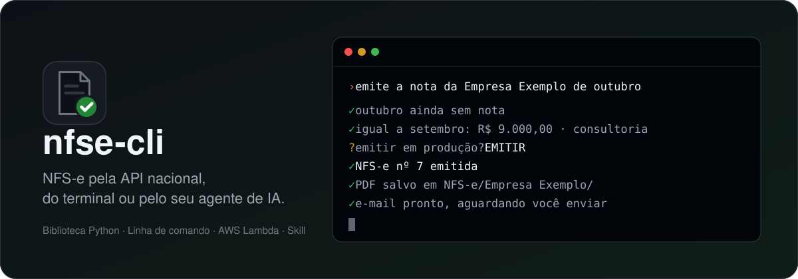
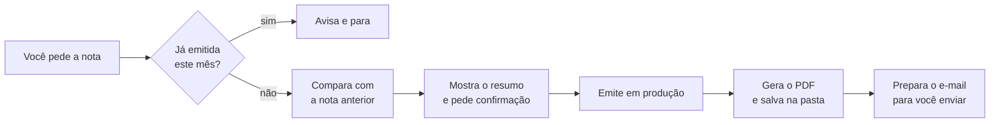

<div align="center">



<h3>
  <a href="#como-a-skill-funciona">Como funciona</a>
  <span> · </span>
  <a href="#instalação">Instalação</a>
  <span> · </span>
  <a href="#segurança">Segurança</a>
  <span> · </span>
  <a href="#documentação">Documentação</a>
</h3>

<p>
  <a href="https://github.com/regisdias/nfse-cli/actions/workflows/ci.yml"></a>
  <a href="#instalação"></a>
  <a href="LICENSE"></a>
</p>

<p>
  <a href="#funciona-com-quais-agentes"></a>
  <a href="#funciona-com-quais-agentes"></a>
  <a href="#funciona-com-quais-agentes"></a>
  <a href="docs/lambda.md"></a>
</p>

</div>

## O que atende e o que não atende

Confira antes de instalar. O que está em ❌ a configuração recusa com aviso, em vez de emitir uma nota errada.

| | ✅ Atende | ❌ Ainda não atende |
|---|---|---|
| **Regime da empresa** | Simples Nacional, ME ou EPP (testado em produção)<br>🟡 Lucro Presumido e Lucro Real sem retenções (a nota é montada e validada, mas ainda não foi testada em produção) | MEI |
| **Cliente** | Empresa (CNPJ) ou pessoa (CPF) no Brasil<br>Nota sem cliente identificado | Cliente no exterior (exportação de serviço) |
| **ISS** | Tributável e recolhido pela própria empresa, no município dela ou em outro | ISS retido pelo cliente<br>Imunidade, exportação, não incidência<br>Benefício municipal, exigibilidade suspensa |
| **Tributos federais** | Sem retenção | Retenção de IR, PIS, COFINS, CSLL ou INSS |
| **Reforma tributária** | Notas sem IBS/CBS, como as aceitas hoje | Grupo IBS/CBS |
| **Valores** | Valor do serviço e tributos aproximados (percentual do Simples, percentual ou valor) | Desconto, dedução da base de cálculo |
| **O que faz com a nota** | Emitir, consultar, baixar o XML e gerar o PDF | Cancelar, substituir, registrar eventos |
| **PDF (DANFSe)** | Leiaute oficial da Nota Técnica 008, com QR Code | Marca d'água de nota cancelada ou substituída |
| **Configuração** | A partir de uma nota anterior (XML, PDF ou chave) ou pergunta por pergunta | |
| **Onde roda** | macOS (testado), Linux e Windows<br>AWS Lambda | Cofre de senha no Linux e no Windows (por enquanto, a senha vai por variável de ambiente ou é digitada) |
| **Agentes** | Claude Code, Codex e Antigravity | |

Se o seu caso está na coluna da direita, use por enquanto o Emissor Web do governo.

---

## O que é

A NFS-e nacional tem uma API própria (Sefin Nacional), autenticada pelo certificado digital A1 da empresa.
Este projeto conversa com ela diretamente: monta a nota, assina, confere contra o esquema oficial e envia.

São quatro peças, cada uma para um jeito de usar:

| Peça | Para quem | O que faz |
|---|---|---|
| **Skill** | Quem usa Claude Code, Codex ou Antigravity | Você pede "emite a nota da Empresa X deste mês" e o agente faz o resto, conferindo tudo com você antes |
| **`nfse`** (linha de comando) | Quem prefere o terminal | Emite, consulta, baixa o XML e gera o PDF |
| **`nfse`** (biblioteca Python) | Quem integra num sistema | Funções sem estado: o sistema guarda numeração e cadastro, a biblioteca cuida da nota |
| **`nfse_lambda`** | Quem roda na AWS | Função pronta para AWS Lambda, com o certificado no Secrets Manager |

## Como a skill funciona

### Na primeira vez: configurar

A skill precisa saber quem emite, que serviço é prestado e para quem. Há dois caminhos:

- **A partir de uma nota que você já emitiu (recomendado).** Entregue o PDF, o XML ou a chave de acesso de uma
  nota anterior. A skill baixa o XML pela API com o seu certificado e copia dele o regime tributário, o código
  do serviço, o ISS, o cliente, o valor e a descrição. No fim, mostra um resumo em português para você
  confirmar.
- **Manual, para a primeira nota da empresa.** A skill pergunta uma coisa de cada vez, e só o que se aplica ao
  seu caso: regime (MEI, Simples, Lucro Presumido), o serviço que você presta (você descreve com suas palavras
  e ela procura o código na tabela nacional), ISS, cliente (pelo CNPJ ela preenche nome e endereço), valor, e
  como você quer receber o PDF e o e-mail.

Os dois caminhos terminam com uma nota de teste em **homologação**, o ambiente de testes da Receita, que não tem
valor fiscal. A produção só fica disponível depois disso.

### Todo mês: emitir



- **Nada vai para produção sem você confirmar.** O resumo da nota vem com um código, e a emissão só acontece
  com esse código: se qualquer dado mudar no meio do caminho, a nota não sai. Se o valor ou a descrição
  mudarem em relação ao mês anterior, a skill para e pergunta.
- **Se a conexão cair no meio,** ela consulta a Receita antes de tentar de novo, para não emitir a mesma nota
  duas vezes.
- **O e-mail fica como rascunho, e quem envia é você.** No Mac com Outlook, a skill abre o rascunho pronto, com
  o PDF anexado. Nos outros casos, deixa um arquivo `.eml` ou só os arquivos na pasta.

## Funciona com quais agentes

A skill segue o padrão aberto [Agent Skills](https://agentskills.io): um `SKILL.md` com as instruções e os scripts
ao lado. O mesmo arquivo serve para os três agentes, e o instalador coloca uma cópia na pasta de cada um que
encontrar na sua máquina:

| Agente | Pasta da skill |
|---|---|
| Claude Code | `~/.claude/skills/nfse/` |
| Codex (OpenAI) | `~/.agents/skills/nfse/` |
| Antigravity (Google) | `~/.gemini/config/skills/nfse/` |

O agente precisa poder rodar comandos no terminal, porque é assim que a skill chama a linha de comando `nfse`.
Outros agentes que leem `SKILL.md` devem funcionar também.

## Instalação

macOS ou Linux, só no seu usuário, sem sudo:

```bash
curl -fsSL https://raw.githubusercontent.com/regisdias/nfse-cli/main/install.sh | bash
```

Depois, abra seu agente e peça **"configura minha nota fiscal"**. Para saber antes de rodar, isto é o que o
instalador faz ([leia o script](install.sh)):

| O quê | Onde | Para quê |
|---|---|---|
| Ambiente Python isolado | `~/.local/share/nfse-cli/` | Não mexe no Python do sistema nem em outros projetos |
| `lxml` e `cryptography` | dentro desse ambiente | Assinar e validar a nota (as únicas dependências do núcleo) |
| `reportlab` | dentro desse ambiente | Gerar o PDF da nota |
| Comando `nfse` | `~/.local/bin/nfse` | A linha de comando, que a skill também usa |
| A skill | as pastas da tabela acima, dos agentes que existirem | Para o agente encontrar a skill |
| Sua configuração | `~/.config/nfse-cli/` | Criada na primeira vez que você configura; não sai da sua máquina |

Pré-requisitos: Python 3.11 ou mais novo e o certificado A1 (`.pfx`) da empresa.

Para atualizar, rode o mesmo comando. Para desinstalar:

```bash
curl -fsSL https://raw.githubusercontent.com/regisdias/nfse-cli/main/install.sh | bash -s -- --desinstalar
```

A configuração em `~/.config/nfse-cli/` continua lá, para o caso de você reinstalar; apague à mão se quiser.

Windows: por enquanto, instalação manual (abaixo), com a senha na variável `NFSE_CERT_SENHA`.

### Instalação manual

```bash
git clone https://github.com/regisdias/nfse-cli.git && cd nfse-cli
python3 -m venv .venv && .venv/bin/pip install -e '.[danfse]'
alias nfse="$PWD/.venv/bin/nfse"
```

Depois, a configuração (é o mesmo caminho que a skill segue por você):

```bash
nfse configurar certificado ~/Downloads/empresa.pfx    # pede a senha e guarda no Keychain
nfse configurar modelo ~/Downloads/nota-anterior.pdf   # ou o XML, ou a chave de acesso
nfse configurar salvar ~/.config/nfse-cli/rascunho.json
nfse emitir --tomador <cliente> --valor 100 --descricao "Teste"   # nota de teste em homologação
```

Primeira nota da empresa, sem nota anterior? Copie `config.exemplo.toml` para `~/.config/nfse-cli/config.toml` e
preencha; `nfse servico`, `nfse nbs` e `nfse municipio` ajudam a achar os códigos.

A senha do certificado fica no cofre do sistema, nunca em arquivo. Fora do macOS, por enquanto, use a variável
`NFSE_CERT_SENHA` ou digite a senha quando o comando pedir.

## Segurança

O certificado A1 assina notas em nome da empresa, e o projeto é construído em volta disso:

- **Nenhuma biblioteca de terceiros específica de NFS-e.** O núcleo usa só `lxml`, `cryptography` e a
  biblioteca padrão do Python. Tudo o que toca o certificado está neste repositório, para você ler.
- **A senha nunca vai para arquivo.** Fica no cofre do sistema (Keychain, no macOS) ou, na Lambda, no Secrets
  Manager. A chave privada fica em memória; ela só passa pelo disco cifrada e por instantes, porque o TLS do
  Python só aceita certificado de cliente vindo de arquivo.
- **Os logs nunca têm XML, dados do cliente nem senha.**
- **Homologação é o padrão.** Produção exige pedido explícito e confirmação: digitada no terminal, ou o código
  do resumo que você aprovou (na Lambda, liberação na própria função).
- **O agente nunca vê a senha.** `nfse configurar certificado` só roda num terminal interativo, onde você digita.
- **Só conversa com a Receita.** As conexões são apenas com os servidores da Sefin Nacional.

Achou uma falha? Veja [SECURITY.md](SECURITY.md).

## Linha de comando

```bash
nfse configurar certificado empresa.pfx            # copia o certificado e guarda a senha (no seu terminal)
nfse configurar modelo <xml | pdf | chave>         # lê uma nota já emitida e monta um rascunho
nfse configurar salvar rascunho.json               # valida o rascunho e grava a configuração
nfse configurar mostrar                            # a configuração atual, em português
nfse servico consultoria informática               # procura o código de tributação nacional
nfse nbs assessoria empresarial                    # procura o código NBS
nfse municipio itajai sc                           # procura o código IBGE do município
nfse skill instalar                                # copia a skill para os agentes instalados

nfse certificado                                   # titular, CNPJ e validade do certificado
nfse dps --tomador cliente --valor 9000 --descricao-arquivo desc.txt   # monta e valida, não envia
nfse emitir --tomador cliente --valor 9000 --descricao-arquivo desc.txt             # homologação
nfse emitir --producao --tomador cliente --valor 9000 --descricao-arquivo desc.txt  # produção (pede EMITIR)
nfse dps --producao --tomador cliente              # resumo com código de confirmação, sem enviar
nfse emitir --producao --tomador cliente --confirmacao A1B2C3   # emite só se nada mudou desde o resumo
nfse notas --tomador cliente                       # notas já emitidas; diz se o mês já tem nota
nfse arquivar <chave de acesso>                    # XML e PDF na pasta do cliente
nfse email <chave de acesso>                       # rascunho do e-mail com o PDF (Outlook no Mac, ou .eml)
nfse consultar --numero 3                          # essa DPS virou nota?
nfse consultar --serie 70000 --numero 3            # idem, para uma nota do Emissor Web
nfse baixar <chave de acesso>                      # XML da nota
nfse danfse <chave de acesso>                      # PDF da nota
nfse danfse --xml nota.xml                         # PDF de um XML salvo, sem internet
```

Sem `--valor` e `--descricao`, valem os do cliente em `[tomadores.<apelido>.recorrente]`; a descrição aceita
`{mes}`, `{mes_min}` e `{ano}`. A numeração da DPS fica em `~/.config/nfse-cli/numeracao.json`, só avança depois
que a nota sai e é conferida na Sefin antes de usar (um número que já virou nota é pulado). A série padrão é 1;
o Emissor Web do governo usa 70000 em diante, então as duas numerações não se cruzam.

## Biblioteca Python

```python
import nfse

cfg = nfse.config_de_dict({
    "prestador": {"cnpj": "11222333000181", "cod_municipio": "3550308", "op_simp_nac": 3, "reg_ap_trib_sn": 1},
    "servico": {"c_trib_nac": "170101", "c_nbs": "114013900", "tot_trib": {"modo": "sn", "percentual": 6}},
})
cert = nfse.Certificado.de_pfx(pfx_bytes, senha)
tomador = nfse.tomador_de_dict({"documento": "11444777000161", "nome": "CLIENTE LTDA"})

r = nfse.emitir(cfg, cert, nfse.HOMOLOGACAO, serie="1", numero=1, valor="9000.00",
                descricao="Consultoria em tecnologia.", tomador=tomador)
print(r.numero_nfse, r.chave_acesso)
pdf = nfse.gerar_danfse(r.xml_nfse)
```

Em outro projeto, instale por versão: `pip install 'nfse-cli @ git+https://github.com/regisdias/nfse-cli@v0.1.0'`.

## Documentação

- [Configuração](docs/configuracao.md): os três passos, o formato do rascunho e onde achar cada código.
- [Como a emissão funciona](docs/emissao.md): assinatura, validação, reenvio seguro e as armadilhas da API.
- [PDF da nota (DANFSe)](docs/danfse.md): por que o PDF é gerado aqui e o que a Nota Técnica 008 exige.
- [AWS Lambda](docs/lambda.md): evento, certificado no Secrets Manager e empacotamento.

## Contribuir

Veja [CONTRIBUTING.md](CONTRIBUTING.md). A regra principal: nenhum dado real (CNPJ, nome, endereço, certificado) em
teste, exemplo ou issue.

## Licença

[MIT](LICENSE): use, modifique e redistribua à vontade. Este não é um software oficial da Receita Federal; confira
com a sua contabilidade a configuração tributária da sua empresa.
